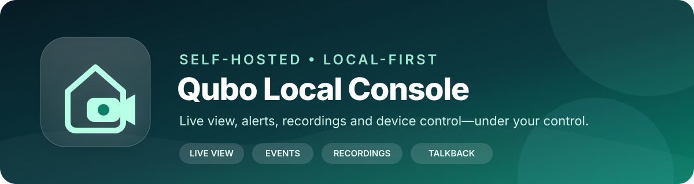
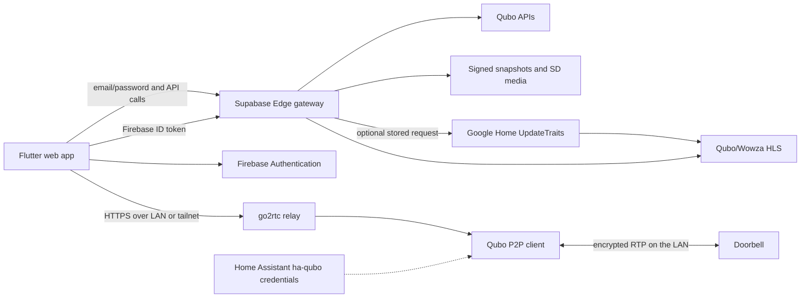

<div align="center">
  

  <h1>Qubo Local Console</h1>

  <p><strong>One private console for your Qubo live view, alerts, recordings, timeline, snapshots, and supported smart-device controls.</strong></p>

  <p>
    
    
    
    
    
  </p>

  <p>
    <a href="#quick-start-map">Quick start</a> ·
    <a href="#architecture">Architecture</a> ·
    <a href="#6-watch-alerts-events-snapshots-and-recordings">Events &amp; recordings</a> ·
    <a href="#7-control-supported-devices">Device control</a> ·
    <a href="#8-set-up-the-preferred-local-doorbell-stream">Local stream</a> ·
    <a href="#troubleshooting">Troubleshooting</a>
  </p>
</div>

---

A responsive Flutter web app for Qubo cameras and doorbells, with an optional
low-latency LAN relay for listening audio and experimental two-way talk. It is
designed to run as a static Firebase site backed by a narrowly restricted
Supabase Edge gateway—no Firebase Functions and no manually started web proxy.

This is a clean, history-free template. It contains no account credentials,
Qubo unit/device identifiers, Firebase project, Supabase project, Home
Assistant path, Google bearer token, or captured request. Values shown below
are placeholders. The fixed Qubo subscriber/app identifiers in the source are
vendor application identifiers used by the observed public client flow; they
are not tied to a user account.

> This project relies on reverse-engineered, undocumented services. Use it
> only with devices and accounts you own, expect upstream behavior to change,
> and keep a supported Qubo app available for recovery.

## At a glance

| Explore | Watch | Review | Control |
| --- | --- | --- | --- |
| Automatic account, home, and device discovery | Local P2P live video with camera audio | Doorbell/VMS alerts with full-frame snapshots | Confirmed power and purifier-mode requests |
| Exact start/end date-time ranges | Optional Firebase-gated cloud HLS | Unified recording and alert timeline | Payload preview before every command |
| Independent source loading and retry | WebRTC low-latency player and talkback | SD-card clip export, playback, and seeking | Advanced editor for independently verified schemas |

## Quick-start map

The complete guide is below. For a first working installation, follow these in
order:

1. [Install dependencies](#1-install-the-project).
2. [Create Firebase Hosting and viewer authentication](#2-create-and-configure-firebase).
3. [Deploy the Supabase gateway](#3-deploy-the-supabase-gateway).
4. [Build and publish the Flutter web app](#4-build-and-deploy-the-web-console).
5. [Sign in to Qubo and discover this account's devices](#5-first-qubo-login-and-discovery).
6. Use the console for [events and recordings](#6-watch-alerts-events-snapshots-and-recordings),
   [device control](#7-control-supported-devices), and the
   [local doorbell stream](#8-set-up-the-preferred-local-doorbell-stream).

> **Recommended path:** get Qubo login, events, and recordings working first;
> add the go2rtc local relay second; configure Google Home cloud HLS only if you
> specifically need that fallback.

## What it provides

- Qubo email/password sign-in, token refresh, expiry warning, and re-login.
- Account-scoped unit and device discovery; no saved account device registry.
- Date/time range selection for doorbell/VMS events and SD-card recordings.
- A combined timeline for recordings, doorbell calls, and available AI data.
- Full-frame north- and south-region event snapshots, detail view, zoom, and
  explicit on-device snapshot saving.
- SD-card clip staging, polling, signed MP4 playback, seeking, and re-export.
- Device command previews and confirmations for observed power and purifier
  mode commands, plus an advanced JSON command editor.
- Optional Google Home HLS cloud live view protected by Firebase Authentication.
- Preferred local P2P doorbell view through go2rtc, including camera audio and
  experimental browser-microphone-to-doorbell talkback.
- A narrow Supabase Edge Function gateway so a Firebase-hosted web build works
  without CORS errors or a manually started local HTTP proxy.

## Architecture



The static Flutter app contains only public build configuration. Qubo session
tokens remain in memory. The optional Firebase refresh token is stored in
browser preferences. The Google Home capture is stored only as a Supabase
Function Secret. The local relay reads Qubo credentials from Home Assistant's
local `.storage` directory or, less preferably, from an untracked `.env` file.

## Repository layout

| Path | Purpose |
| --- | --- |
| `lib/` | Flutter UI, account discovery, event flow, controls, and players |
| `supabase/functions/qubo-proxy/` | Restricted CORS/media/live-view gateway |
| `scripts/build-web.mjs` | Validated production web build |
| `scripts/deploy-google-home-capture.mjs` | Uploads a private Home request as a Function Secret |
| `tools/go2rtc/` | Local P2P video/audio/talkback relay |
| `docs/api-inventory.md` | Observed API behavior and known limitations |
| `test/` | Synthetic Dart and Node tests; no real account values |

## Prerequisites

For the hosted console:

- A Qubo account with email/password sign-in enabled and at least one
  supported device. The console and `ha-qubo` integration use Qubo
  email/password authentication; end users should not copy access tokens into
  the GUI.
- Flutter compatible with the SDK constraint in `pubspec.yaml`.
- Node.js 18 or newer.
- A Firebase project on the Spark plan is sufficient for static Hosting and
  email/password Authentication.
- A Supabase project and the Supabase CLI. The Edge Function is required for
  browser CORS and media proxying; it does not use a database or Supabase Auth.
- Firebase CLI for deployment.

For local doorbell streaming, also install Docker Engine on an always-on Linux
machine on the doorbell's LAN. Home Assistant with the `ha-qubo` integration is
the recommended credential source. Tailscale is optional but is the easiest
way to use the relay remotely without exposing go2rtc to the public Internet.

## 1. Install the project

```bash
cd /path/to/qubo-local-console
flutter pub get
firebase login
supabase login
```

Do not create or commit `.env`, `.firebaserc`, packet captures, Firebase admin
keys, Supabase service-role keys, access/refresh tokens, signed media URLs, or
Home Assistant `.storage` files.

## 2. Create and configure Firebase

1. Create a Firebase project in the Firebase Console.
2. Open **Build → Authentication → Sign-in method** and enable
   **Email/Password**.
3. Open **Authentication → Users** and create each person allowed to use the
   Live view page. The app deliberately has no public sign-up flow.
4. Add a Web app in **Project settings → Your apps**. Record its project ID
   and Web API key. A Firebase Web API key is a public client identifier, but
   restricting it to the APIs and sites you use is still recommended.
5. Enable Firebase Hosting and associate this directory with the project:

```bash
cp .firebaserc.example .firebaserc
# Replace your-firebase-project-id in .firebaserc.
firebase use your-firebase-project-id
```

If you use a custom domain, finish Firebase's domain verification before
configuring the gateway origin in the next section.

## 3. Deploy the Supabase gateway

Choose values for this installation:

```bash
export SUPABASE_PROJECT_REF='your-supabase-project-ref'
export FIREBASE_PROJECT_ID='your-firebase-project-id'
export FIREBASE_WEB_API_KEY='your-firebase-web-api-key'
export QUBO_PROXY_URL="https://${SUPABASE_PROJECT_REF}.supabase.co/functions/v1/qubo-proxy"
export QUBO_ALLOWED_ORIGINS="https://${FIREBASE_PROJECT_ID}.web.app,https://${FIREBASE_PROJECT_ID}.firebaseapp.com,http://localhost:8080,http://localhost:5173"
```

`QUBO_ALLOWED_ORIGINS` must contain exact origins, without paths or trailing
slashes. Add a custom Firebase domain if you use one.

Upload the non-secret gateway configuration and deploy:

```bash
supabase secrets set \
  --project-ref "$SUPABASE_PROJECT_REF" \
  FIREBASE_PROJECT_ID="$FIREBASE_PROJECT_ID" \
  QUBO_ALLOWED_ORIGINS="$QUBO_ALLOWED_ORIGINS"

supabase functions deploy qubo-proxy \
  --project-ref "$SUPABASE_PROJECT_REF" \
  --no-verify-jwt \
  --use-api
```

`verify_jwt = false` is intentional and is also declared in
`supabase/config.toml`: users authenticate to Qubo with Qubo credentials, while
the function verifies Firebase ID tokens itself for cloud live-view requests.
The handler has a strict destination and method allow-list; it is not a general
open proxy.

Test that the function is present. A request without a target should return a
structured `PROXY_INVALID_TARGET` response, not an HTML page or a deployment
404:

```bash
curl -i "$QUBO_PROXY_URL"
```

## 4. Build and deploy the web console

The build script refuses to run until all public client settings are present:

```bash
export FLUTTER_BIN=/absolute/path/to/flutter   # optional when flutter is on PATH
node scripts/build-web.mjs "$QUBO_PROXY_URL"
firebase deploy --only hosting
```

The equivalent direct command is:

```bash
flutter build web --release \
  --dart-define="QUBO_PROXY_URL=$QUBO_PROXY_URL" \
  --dart-define="FIREBASE_PROJECT_ID=$FIREBASE_PROJECT_ID" \
  --dart-define="FIREBASE_WEB_API_KEY=$FIREBASE_WEB_API_KEY"
firebase deploy --only hosting
```

For local development, keep using the deployed Supabase gateway:

```bash
flutter run -d chrome \
  --web-port 8080 \
  --dart-define="QUBO_PROXY_URL=$QUBO_PROXY_URL" \
  --dart-define="FIREBASE_PROJECT_ID=$FIREBASE_PROJECT_ID" \
  --dart-define="FIREBASE_WEB_API_KEY=$FIREBASE_WEB_API_KEY"
```

There is no production local proxy to start. `bin/proxy.dart` is only a
diagnostic tool. If the hosted app reports an origin error, update
`QUBO_ALLOWED_ORIGINS`, redeploy the function, and hard-refresh the browser.

## 5. First Qubo login and discovery

1. Open the deployed site and choose **Events** or **Connection**.
2. Leave the vendor tenant/app defaults unchanged unless Qubo changes its
   official client flow. Leave **Unit UUID** and the device array empty on a
   clean installation; authenticated discovery populates them.
3. Confirm the hosted gateway URL is your own Supabase function URL.
4. Sign in with the email and password used by the Qubo app. This is the
   supported GUI authentication path; the app obtains and refreshes Qubo
   access tokens on the user's behalf. The client reports
   itself as `Apple iPhone15,5`, obtains account profiles, units, and devices,
   then selects a camera/doorbell when available.
5. If the account has more than one profile, choose the correct profile.

The installation ID is generated locally and must stay consistent for login,
refresh, and API calls during the session. Qubo tokens and discovered settings
are reset on page reload. The client refreshes a refreshable access token in
its last five minutes and retries one request after a 401. If refresh is
rejected, the UI blocks authenticated pages and asks the user to sign in again.

The **Connection** page is an advanced fallback. Use it only when discovery
omits metadata needed by a feature:

- `entityUUID` for device controls.
- `handleName` for purifier mode commands.
- model and MAC address for the RTSP-support lookup.
- unit/device IDs when an upstream discovery response is incomplete.

Saving Connection changes signs the current Qubo session out.

## 6. Watch alerts, events, snapshots, and recordings

### Fetch a time range

1. Open **Events**.
2. Select the doorbell/camera.
3. Choose a start date/time and end date/time in the device's local timezone.
4. Select **Fetch events**.

The sources load independently, so one source can fail without erasing the
others. Doorbell/VMS history is paginated backward and filtered to the exact
range. SD-card time-scrubber entries are requested for the same range. The AI
endpoint currently exposed by this project returns the latest observed event,
not a complete historical AI feed; the UI includes it only when it belongs to
the selected device and range.

### Use the timeline

Open **Timeline** after fetching a range. The scrubber draws:

- SD-card recording intervals.
- Doorbell call/alert markers.
- Available AI detection markers.

Selecting an alert opens its details and, when timestamps overlap, associates
it with the containing recording. This is correlation by time, not a server
guarantee.

### View and save snapshots

Open an event card to see metadata and the full snapshot. Images use `contain`
layout so the complete frame remains visible rather than being cropped. Both
north- and south-region signed Airtel URLs are supported. Signed URLs are
short-lived; use the event's refresh action when the API can issue another
URL. If an AI response contains only a filename, the app cannot safely invent
the missing signature—supply a matching signed capture URL in the detail view
when available.

**Save snapshot** stores only the image bytes in the current browser/device;
it does not retain the signed URL. Remove saved copies from the same detail
view.

### Play SD-card recordings

1. Select an SD interval in Timeline or event details.
2. Choose the export/play action.
3. The app requests staging, polls the returned transaction, and plays the
   short-lived signed MP4 when ready.
4. If the link expires or a range request fails, request a fresh export.

The generated clip is normally a limited window around the selected interval,
not an unlimited archive download. Recordings depend on the camera's SD card
and Qubo's push-pull service.

## 7. Control supported devices

Open **Devices** after Qubo login and discovery.

- Power-on uses the observed shadow-update payload.
- Power-off remains labelled unverified because a matching successful capture
  was not available.
- Supported air-purifier cards expose the observed `qsense` and `sleep` modes.
- **Advanced command** accepts a known JSON service/shadow payload for models
  whose schema you have independently verified.

Every action first previews the destination and payload and requires explicit
confirmation. A successful API acknowledgement means the server accepted the
request; it does not prove the physical device changed state. Do not guess
speed/mode field names. If a card says metadata is missing, add the device's
account-owned `entityUUID` and, for purifier modes, `handleName` in
**Connection**, then sign in again.

## 8. Set up the preferred local doorbell stream

The local path uses Qubo only for session signalling. Video/audio packets then
travel directly from the doorbell to the Linux relay. Do this on a machine that
stays on and is on the same LAN as the doorbell.

### 8.1 Install the relay prerequisites

Install Docker Engine and FFmpeg. Confirm Docker starts at boot:

```bash
sudo systemctl enable --now docker
docker version
ffmpeg -version
```

The container image must be able to install/use Python's `cryptography`
dependency. The bundled client can populate its private `_libs` directory when
needed; see `tools/go2rtc/README.md` if startup reports
`ModuleNotFoundError: cryptography`.

### 8.2 Obtain the relay identifiers

You need:

- `QDEVICE`: the doorbell device UUID shown after console discovery.
- `QUNIT`: the selected device's unit UUID, also shown on Live view.
- `QMOB`: the UUID of a phone already paired to the Qubo account. Find it in
  Qubo **Account → Logged In Devices**, or in the `ha-qubo` Home Assistant
  config entry. Do not use the console's generated installation ID.
- `QADVERT`: the relay machine's LAN IP, for example `192.168.1.10`.

The recommended credential source is a working Home Assistant `ha-qubo`
integration. Configure or re-authenticate that integration with the Qubo
account's email and password. `ha-qubo` obtains and stores the Qubo access and
refresh tokens; users should not manually create or paste those tokens. Then
locate the Home Assistant configuration directory. The relay mounts its
`.storage` directory read-only and follows token rotations without copying
credentials into this project.

Without Home Assistant, leave `HA_CONFIG_DIR` blank and add `QACCESS` (current
Qubo access token), `QUUID` (Qubo user UUID), and optionally `QREFRESH` and
`QSOURCE` to `.env`. Then use `./run-docker.sh`; the supplied Compose file
expects the Home Assistant mount. Standalone credentials expire and must be
replaced or refreshed, so this mode is intended for diagnosis rather than an
unattended installation.

### 8.3 Configure and start go2rtc

```bash
cd tools/go2rtc
cp .env.example .env
```

Edit `.env`:

```dotenv
HA_CONFIG_DIR=/path/to/home-assistant/config
QDEVICE=your-doorbell-device-uuid
QUNIT=your-home-unit-uuid
QMOB=your-paired-phone-uuid
QADVERT=192.168.1.10
QPORT=49700
QAUDIO=true
QTALK=false
```

Keep `.env` untracked. Start with either the base Docker CLI helper:

```bash
./run-docker.sh
```

or Docker Compose v2:

```bash
docker compose up -d
```

If `docker compose` reports `unknown shorthand flag: 'd'`, Compose v2 is not
installed; use `./run-docker.sh`.

Verify the relay:

```bash
docker ps --filter name=qubo-go2rtc
docker logs -f qubo-go2rtc
tail -f qubo_err.log
curl -I 'http://127.0.0.1:1984/stream.html?src=qubo_doorbell'
```

Open this on the LAN:

```text
http://192.168.1.10:1984/stream.html?src=qubo_doorbell
```

The Docker restart policy is `always`. After the first successful run, verify:

```bash
docker inspect --format '{{.HostConfig.RestartPolicy.Name}}' qubo-go2rtc
```

### 8.4 Add the relay to the Flutter Live view page

Open **Live view → Local relay**, enter the go2rtc base URL (not the
`stream.html` URL), keep the stream name `qubo_doorbell`, and choose:

- **Play locally** for embedded HLS when the page and relay use compatible
  security schemes.
- **Open low-latency player** for go2rtc's WebRTC/MSE viewer.
- **Open two-way talk** for video, listen audio, and microphone backchannel.

An HTTPS-hosted Firebase page cannot embed a plain HTTP LAN URL because of
browser mixed-content rules. A top-level HTTP player can still be opened on a
trusted LAN. For embedded playback and microphone permission, use trusted HTTPS.

### 8.5 Optional private remote access with Tailscale

Install Tailscale on both the relay and viewing device. Do not reuse a Serve
port already assigned to another application. For example:

```bash
tailscale serve --bg --https=8443 http://127.0.0.1:1984
tailscale serve status
```

Then enter this base URL in Live view:

```text
https://your-relay.your-tailnet.ts.net:8443
```

The viewing device must be signed into the same tailnet. If Safari shows an old
404 while `curl` succeeds, clear the site's cache and retry. Secure DNS on an
unconnected device cannot resolve a tailnet-only hostname; connect Tailscale
or use the LAN IP while on the LAN.

Never expose an unauthenticated go2rtc API to the public Internet. It supports
an `exec` source and therefore must remain on a trusted LAN/tailnet or behind
strong authentication.

### 8.6 Enable listen audio and two-way talk

Listen audio is enabled by default with `QAUDIO=true`. First verify the log
contains `detected ADTS AAC` and that a WebRTC player offers an audio track.
Doorbells can be quiet; `QAUDIOGAINDB=20` is the current receive gain default.

For talkback:

1. Use headphones for the first test.
2. Set `QTALK=true` in `tools/go2rtc/.env`.
3. Optionally set `QTALKGAINDB=12`; increase gradually to `15` or `18` only if
   speech remains quiet and undistorted.
4. Restart: `docker restart qubo-go2rtc`.
5. Open the trusted HTTPS endpoint with **Open two-way talk**.
6. Allow microphone access and activate the microphone control in the go2rtc
   player.

Talkback is experimental. Disable it immediately if the doorbell emits
distorted audio. Detailed codec, gain, token-refresh, and diagnostic notes are
in [`tools/go2rtc/README.md`](tools/go2rtc/README.md).

## 9. Optional Google Home cloud HLS live view

The local relay is preferred. Cloud HLS is a fallback and requires a fresh,
private Google Home `UpdateTraits` request capture plus its corresponding
response. Captures contain bearer/context credentials: never commit them,
share them, or compile them into Flutter.

Before capturing anything, link the Qubo account to Google Home in the Google
Home app and confirm that the doorbell appears and can open live view there.
Firebase Authentication only controls who can open this console's Live view
page; it does not link Qubo to Google Home and cannot provision the camera in
Google Home.

After obtaining an authorized request/response pair for your own doorbell:

```bash
node scripts/deploy-google-home-capture.mjs \
  /secure/path/request.txt \
  /secure/path/response.txt \
  "$SUPABASE_PROJECT_REF"

supabase functions deploy qubo-proxy \
  --project-ref "$SUPABASE_PROJECT_REF" \
  --no-verify-jwt \
  --use-api
```

Sign in on **Live view** with the Firebase email/password created in step 2.
That login is independent of Qubo login. The Edge Function validates the
Firebase ID token, replays the stored request, extracts the HLS master, and
rewrites the plain-HTTP master, child playlists, and segments through HTTPS.

Google OAuth/context and Wowza sessions expire. The player renews failed/stale
sessions within bounded retry rules, but `PROXY_LIVE_RESPONSE_EMPTY`, gRPC 16,
or repeated preset errors mean a fresh capture is required. A different HLS
origin/path may require a deliberate gateway allow-list code update.

## Security model

- The repository and its tests contain synthetic identifiers only.
- `.env`, `.firebaserc`, raw captures, build output, and common local tooling
  state are ignored.
- Qubo passwords are sent only to Qubo and are not stored or included in
  request activity logs.
- Qubo access/refresh tokens stay in memory and disappear on reload.
- Firebase live-view refresh tokens are stored in browser preferences; use
  dedicated viewer accounts and revoke them from Firebase when needed.
- The Google Home capture belongs only in `GOOGLE_HOME_CAPTURE_B64`, a Supabase
  Function Secret.
- The proxy accepts only known hosts, paths, methods, storage prefixes, and
  media shapes; redirects are rejected and account headers are stripped from
  storage requests.
- Signed snapshot/video URLs are credentials until expiry. Do not log or share
  their query strings.
- go2rtc must remain private or be protected by authentication and trusted TLS.

Before publishing a fork, run a history-aware secret scanner as well as a
working-tree scan. This directory intentionally has no Git history; initialize
a new repository only after reviewing every file.

## Validation

```bash
flutter analyze
flutter test
node --test test/proxy/*.test.mjs
python3 -m unittest tools/go2rtc/test_qubo_p2p_client.py
```

The tests use synthetic UUIDs, fake tokens, and mocked HTTP responses. They do
not log in, send device commands, contact a camera, or replay captured traffic.

## Troubleshooting

| Symptom | Check |
| --- | --- |
| Browser shows CORS/403 | Exact site origin in `QUBO_ALLOWED_ORIGINS`; function redeployed; `verify_jwt=false` |
| Gateway returns 400 on every call | `QUBO_PROXY_URL` must end in `/functions/v1/qubo-proxy` and contain no query string |
| Qubo login rejected | Verify Qubo credentials in the official app; keep vendor defaults and generated installation ID consistent |
| Old account's events appear | Clear stale Connection overrides, reload, sign in, and let discovery repopulate unit/device IDs |
| Time scrubber says data missing | Verify selected device/unit and range; ensure timestamps are current and the camera has SD recordings |
| Snapshot unsupported | Use the exact signed north/south URL returned by Qubo; do not reconstruct a signature from a filename |
| SD clip fails after working | Signed MP4 expired; request a new export |
| Firebase live login fails | Enable Email/Password and rebuild with the matching project ID and Web API key |
| `PROXY_LIVE_PRESET_MISSING` | No valid `GOOGLE_HOME_CAPTURE_B64` secret is deployed |
| Cloud video stalls/404s | Allow session renewal; repeated failures need a fresh Home capture |
| Local player loads but no media | Inspect `qubo_err.log`; verify LAN IP, UDP port, identifiers, and refreshed HA credentials |
| `p2pCall rejected (400)` | Wait for the previous camera session to release; avoid rapid retries/multiple publishers |
| Local video has no sound | Confirm ADTS AAC detection, use WebRTC, and inspect `QAUDIO*` settings |
| Talk button has no effect | Use trusted HTTPS, allow microphone, set `QTALK=true`, and open the two-way-talk player |
| Tailscale hostname does not resolve | Install/connect Tailscale on the viewing device and verify `tailscale serve status` |

## Known limitations

- Qubo APIs and payloads are undocumented and can change without notice.
- Complete historical AI-event enumeration and AI snapshot signing are not
  established; the latest-event endpoint is not equivalent to AI history.
- Device power-off and arbitrary speed/mode schemas are not verified.
- Cloud Home capture replay is temporary by nature and is not a general Google
  Home OAuth implementation.
- Local P2P audio/talkback is model- and firmware-sensitive and remains
  experimental.
- A server acknowledgement is not proof of physical device state.

For route-by-route evidence and assumptions, read
[`docs/api-inventory.md`](docs/api-inventory.md).
